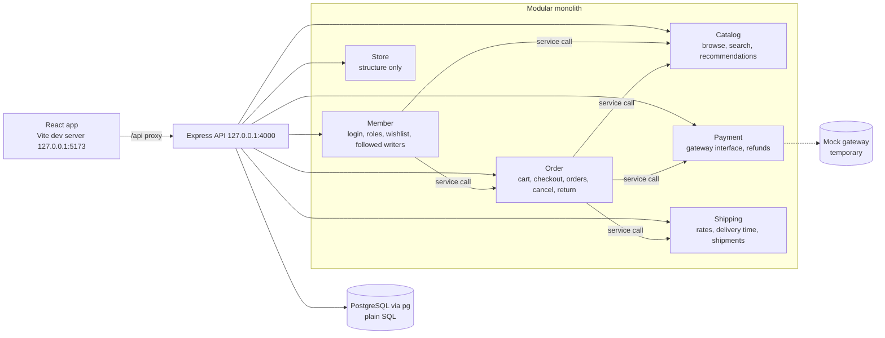

# Book Worm: Architecture and Decisions

Status: written at the end of Phase 8 (2026-11-19). Source of truth for design: [plan.md](../specs/001-member-auth-catalogue/plan.md), [spec.md](../specs/001-member-auth-catalogue/spec.md) and the per-phase reports in [tasks.md](../specs/001-member-auth-catalogue/tasks.md).

## 1. Pending Admin approval and payment status

**Six decisions are still PENDING ADMIN APPROVAL.** Nothing below was decided by the developer. Each placeholder exists only so work was not blocked. It is labelled `PENDING ADMIN APPROVAL` in code, isolated, and reversible.

| # | Decision | What the code does today (provisional, not final) | Where it lives |
|---|----------|----------------------------------------------------|----------------|
| 1 | Brand vs Publisher | The spec says Publisher and the diagram says Brand. The data uses "publisher"; one naming layer keeps a rename cheap. | `publishers` table, catalog module |
| 2 | Single vs multiple categories per book | A join table allows either outcome. Seed data gives each book one or two categories, which is itself provisional. | `book_categories`, migration 001 |
| 3 | Admin roles and permissions | Roles Guest, Member and Admin. The only Admin action is the shipment and return status override (FR-059a). No Admin screen exists. | `authorize("ADMIN")` in `order.routes.js`; migration 002 |
| 4 | Store responsibilities | The Store module is structure only. No store, catalogue or policy management exists. | `backend/src/modules/store/` |
| 5 | Inventory rules | A stock count is used only for availability. Stock is taken when payment starts and given back on failure, abandonment or cancellation. No reservation or threshold rules. "Out of stock" comes from one function. | `availableCopies` in `cart.service.js` |
| 6 | Payment provider and payment lifecycle | A temporary mock gateway behind a swappable `PaymentGateway` interface. | `backend/src/modules/payment/gateway/` |

Also pending: whether gift points and coupons belong to Order or Payment (the diagram shows "Gift & Wallet" under Payment and "Redeem Gift points, Coupons" under Order). Today they sit in Order.

**Payment is PARTIAL.** FR-072..FR-080, SC-014, SC-015, SC-015a and SC-021 are **not fully satisfied**. They are tested only against the mock. Passing mock tests does not mean the requirements are met. The mock never receives, stores or logs card, UPI or bank details; only a method name, an amount, a reference and a test flag. The "simulate a decline" option is ignored in production.

## 2. Architecture

The [architecture diagram](architecture-diagram.png) is authoritative and was not changed (gate G3 never triggered). Flow kept: Registered User, User Login, Home Page; Guest User, Home Page; Home Page, Browse, Add to Cart, Payment Processing, Shipment.

| Module | Diagram responsibilities | Built |
|--------|--------------------------|-------|
| Member | Guest and registered users, login and logout, role and entitlement | Register, sign in by email or mobile, sign out, profile, roles. Also (Phase 7.5) wishlist and followed writers |
| Store | Create stores, catalogues, policies | Structure only (pending) |
| Catalog | Browse by category and brand, order-history recommendations, up-sell and cross-sell | Home sections, 20 genre options, search, filters, sort, paging, authors, publishers, details, related books, recommendations. "Browse by entitlement" is not built (roles pending) |
| Order | Create and modify order, checkout, confirm, cancel, return, history, gift points and coupons | Guest and member cart, addresses, checkout, orders, 48-hour cancellation, returns, Buy Again, gift points, coupons |
| Payment | Gateway payment, refunds, confirmation, gift and wallet | Idempotent mock payment (Card, UPI, Net Banking, COD), refunds. Wallet is not built |
| Shipping | Shipping rate, approximate delivery time, return shipment | Zone-based charge and estimate, timed shipment steps, Admin override, return shipment |

**Layers.** Each module has routes, a service and a repository. SQL lives only in repositories. Business rules live in the backend. The frontend only calls the API.

**Frontend.** React pages and components, context for auth, cart, wishlist and writers, an API client, dark theme, responsive layout.

**Database.** Seven numbered migrations, each with a rollback. The idempotent seed gives 19 categories (plus the UI-only "All"), 228 books, sample members, orders, shipping zones, coupons and configuration.

## 3. Decisions made

| Decision | Reason |
|----------|--------|
| Modular monolith, one folder per diagram module | Matches the diagram and constitution III; simple to run |
| JavaScript only, plain SQL with `pg`, no ORM, no TypeScript | Chosen by the Admin; parameterized queries, easy to read |
| Cart lives in Order | "Add to Cart" feeds the order flow |
| Wishlist and followed writers live in Member (D1) | They are member-owned data and the diagram has no box for them; no diagram change |
| Modules call each other only through service functions | Constitution III; Member reads books through Catalog and adds to cart through the Order cart service |
| Prices, totals, shipping and discounts are always computed on the server | Constitution IV |
| JWT in an httpOnly, sameSite cookie; bcrypt hashes; rate-limited sign-in | Constitution I |
| Guest cart is found by a random token in an httpOnly cookie (only its hash is stored) and is merged on sign-in | Guests can shop without an account |
| Payment takes an idempotency key stored as `memberId:clientKey`; two transactions with the gateway call between them; one successful payment per order | Constitution V; no double charge |
| An order is confirmed only after authorization; failure never consumes stock, coupons or points | Constitution V |
| Cancellation window, return window, shipping charge, timers and gift-point rates are rows in `app_config` | Constitution VIII (configurable rules) |
| Shipment moves on timers (minutes) plus an Admin-only override | FR-059a, so demos need no waiting |
| Estimated delivery is labelled as an estimate until dispatch | SC-018 |
| Refund after cancel: order is cancelled first, then the gateway is called. A gateway failure leaves the refund PENDING and a 30-second sweep retries it | A gateway outage must not block a cancel |
| Inactive wishlisted books return only id, title, cover and a reason | No data leak, no stale price |
| API description is a YAML file served as-is at `/api/openapi.yaml`; no Swagger UI | Avoids a new dependency |
| Local SVG covers generated by the project | No licensing issue, no external calls |
| Generated passwords for sample members are printed once and never stored in clear text | No credentials in the repository |

## 4. Security summary

- Services bind to 127.0.0.1. The only CORS origin is the configured frontend.
- Secrets come from git-ignored `.env` files; only `.env.example` templates with placeholders are committed.
- Every member query is scoped by the session's member id. Other members' data returns 404.
- Input is validated on the server with zod. Errors are generic (oversized bodies give 413, unknown routes 404).
- Logs (pino) hold no passwords, tokens, card data or personal data.
- Dependencies: backend production audit is clean. One high advisory (`picomatch` ReDoS, GHSA-fc5q-39xc-vjpf) affects the dev toolchain of both apps through Vite and Vitest. No patched version is published and the forced fix would downgrade Vite and Vitest. It is open and must be re-checked.

## 5. Quality summary (end of Phase 8)

- Backend: 214 tests pass; coverage of `src/` about 95% statements, 97% lines.
- Frontend: 95 tests pass; production build succeeds.
- Browser audit (axe-core, WCAG 2 A/AA) over 9 pages at 375, 768 and 1280 px plus both dialogs: 0 issues, no sideways scroll, keyboard reachable, dialogs trap focus.
- The critical purchase flow (sign in, browse, cart, pay, confirm, cancel) has integration tests.

## 6. Known limits

- Payment is a mock; the six pending items are unresolved; no Admin screens exist.
- Contrast was checked on the dark theme only. Automated checks do not replace a screen-reader pass.
- `server.js` (boot code and the 30-second sweep) has no unit test.
- Wallet, entitlement-based browsing, up-sell and cross-sell beyond related books, sharing and alerts are not built.
- The app is set up for local development only. A real deployment needs TLS 1.2 or higher, a managed secret store, a production-grade process manager and a real gateway.
